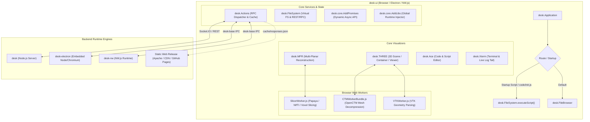
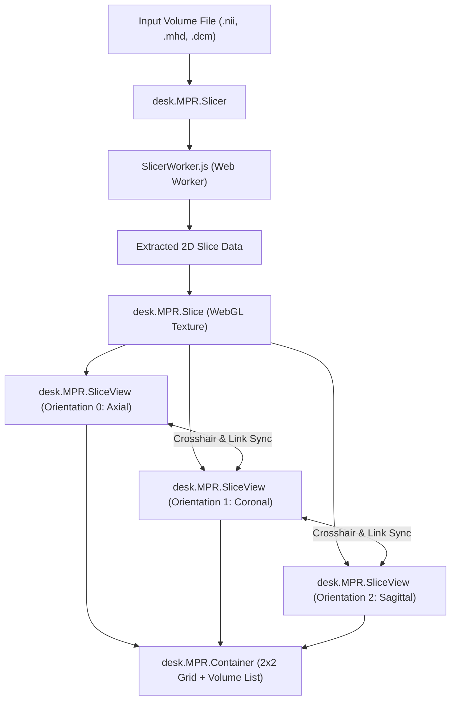

# DESK-UI Architecture Documentation

## 1. Executive Summary

`desk-ui` is a web-based desktop environment and visualization framework engineered primarily for high-performance 3D visualization, processing, and multi-planar reconstruction (MPR) of volumetric medical images (such as CT, MRI, NIfTI, DICOM, and MetaImage formats). 

Built upon the [Qooxdoo](https://qooxdoo.org/) (qx) component framework and [Three.js](https://threejs.org/) for WebGL acceleration, `desk-ui` decouples the front-end user experience from intensive computation by delegating heavy processing to backend services (via JSON-defined RPC actions) and dedicated Web Workers.



---

## 2. Technology Stack & Runtime Foundations

| Subsystem | Primary Technologies | Purpose |
| :--- | :--- | :--- |
| **UI Framework** | [Qooxdoo](https://qooxdoo.org/) (qx 7.x) | Class-based OOP architecture, widget hierarchy, themes, event bus, drag-and-drop, layout managers, data binding. |
| **3D Rendering** | [Three.js](https://threejs.org/) (WebGL / WebGL2) | 3D mesh rendering, TrackballControls2, lighting, custom shaders, surface clipping, camera management. |
| **Medical Imaging** | [Papaya Viewer](https://github.com/rii-mango/Papaya), MHD Parser | Volumetric voxel slicing, NIfTI / DICOM / MHD header parsing, Multi-Planar Reconstruction (MPR). |
| **Code Editing** | [Ace Builds](https://ace.c9.io/) | In-browser syntax-highlighted code editor for JavaScript, C/C++, JSON, HTML, Python, and GLSL. |
| **Terminal & Logging** | [xterm.js](https://xtermjs.org/), Chalk | Embedded pseudo-terminals, ANSI color logging, and real-time streaming file tailing. |
| **Data & Scientific** | D3.js, Billboard.js, Numeric, Chroma.js, kdt, Heap, jStat, Random-js | Color lookup tables (LUTs), charts, mathematical and statistical calculations, spatial indexing. |
| **Concurrency** | Dedicated HTML5 Web Workers (`SlicerWorker`, `CTMWorkerBundle`, `VTKWorker`) | Offloading decompression and slice extraction off the UI thread to maintain 60 FPS responsiveness. |

---

## 3. Runtime Modes and Execution Environments

`desk-ui` is designed to run seamlessly in four distinct environments:

### 3.1. Web Client + Node.js Backend (`desk`)
- **Transport**: Socket.IO client connecting to `${baseURL}socket.io` plus HTTP REST for static asset serving.
- **Communication Flow**:
  - The client emits an `action` event with a unique random `handle` and execution parameters.
  - The backend spawns the configured command-line executable or script, streaming status (`action started`, `actionEvent` with stdout/stderr chunks, `action finished`).
  - Automatic reconnection handling with status resynchronization (`__onDisconnect`).

### 3.2. Electron Desktop Application (`desk-electron`)
- Powered by `electron` and the `desk-base` native Node bridge.
- Uses IPC render communication (`ipcRenderer`) for native file dialogs, system alerts, and direct process spawning without network roundtrips.

### 3.3. NW.js Desktop Application (`desk-nw`)
- Similar to Electron, NW.js shares the same Node context directly in the DOM window through `desk-base`.

### 3.4. Static "Statifier" Mode (Decoupled Web Release)
- For distributing interactive medical imaging studies without requiring an active server backend.
- `desk.Actions` records all file queries and RPC responses into `cache/responses.json`.
- In static deployments, `desk-ui` matches action parameter hashes against the pre-computed cache, simulating live server responses instantly in static hosting environments (e.g., Apache, GitHub Pages, or S3).

---

## 4. Core Subsystems

### 4.1. The RPC Action Framework (`desk.Actions` & `desk.Action`)

The Action framework turns command-line executables and server routines into web-callable RPC services.

```
   +------------------+         Action Spec (.json)         +-------------------+
   |   User Interface | <---------------------------------- |   Server Action   |
   |   (desk.Action)  |                                     |    Registry       |
   +------------------+                                     +-------------------+
            |                                                         |
            | desk.Actions.execute(params)                            |
            v                                                         v
   +----------------------------------------------------------------------------+
   |                             desk.Actions                                   |
   |  - Assigns unique handle (Math.random)                                     |
   |  - Handles SHA-1 caching & cache bypassing (forceUpdate)                   |
   |  - Streams stdout / stderr to registered listeners                         |
   |  - Tracks running & completed actions in Actions Window                    |
   +----------------------------------------------------------------------------+
            |
            | Socket.IO emit("action", params)
            v
   +------------------+
   |   Node / Native  | ===> Spawns OS Process (e.g. ACVD, Slicer, Segmentation)
   |   Backend Server | <=== Streams output / exit status back to client
   +------------------+
```

- **`desk.Actions` (Singleton)**:
  - Global action dispatcher, connection manager, and task monitor.
  - Manages the floating "Actions" inspector showing active processes, execution history, CPU load monitor, and terminal links.
  - Dynamic cache validation: Actions produce deterministic output keyed by input parameter hashes. If an action's result is cached, execution completes immediately without running backend processes.
- **`desk.Action` (Composite Widget)**:
  - Generates UI forms automatically from an action's parameter JSON description.
  - Supports action chaining and pipelining via `.connect(parameter, parentAction, file)`: connecting an output file of one action to an input parameter of another.
  - Embeds input controls, an output file viewer tab, and real-time execution logs.

### 4.2. Virtual File System (`desk.FileSystem`)

`desk.FileSystem` abstracts remote file operations behind a unified client-side interface:
- **Path Resolution**: Converts relative workspace paths (e.g., `data/study1/volume.nii`) to server URLs (`desk.FileSystem.getFileURL()`).
- **File I/O**: `readFile`, `writeFile`, `writeJSON`, `writeCachedFile`, `mkdirp`, `readDir`, `exists`, `traverse`, `downloadFile`.
- **Dynamic Script Execution**: `executeScript(file, callback)` loads JavaScript files on the fly into an isolated function context with `__dirname` bindings.
- **Session Management**: Automatically organizes iterative pipeline runs into versioned session directories (`<filename>.<sessionType>.<sessionId>`).

### 4.3. 3D Visualization Pipeline (`desk.THREE.*`)

The 3D visualization subsystem integrates Three.js into the Qooxdoo layout model:

```
  desk.LinkMixin (Synchronized Multi-View Cameras)
        |
  desk.THREE.Scene (Base Three.js Scene, Camera, WebGLRenderer, TrackballControls2)
        |
  desk.THREE.Container (File Tree, Mesh Management, Loaders, Animator, Clipping)
        |
  desk.THREE.Viewer (Standalone Window wrapper with desk.WindowMixin)
```

- **Canvas Lifecycle & Pooling**: `desk.THREE.Scene` pools WebGL canvases in an internal garbage composite (`__garbageContainer`) to avoid WebGL context loss from frequent DOM attaching/detaching.
- **TrackballControls2**: Custom trackball controller with smooth zoom, rotation, and point-of-interest picking (hitting 'G' centers and animates the camera target to the hovered surface point).
- **Multi-Format Loader Support**:
  - `OpenCTM` (.ctm): High-compression triangle meshes decompressed in parallel via `CTMWorkerBundle.js`.
  - `VTK` (.vtk, .vtp): Polygonal datasets parsed using `VTKWorker.js`.
  - Standard formats: OBJ, PLY, STL, XYZ via Three.js loader addons.
- **`desk.LinkMixin`**: Allows multiple 3D containers and 2D slice views to synchronize camera rotation, zoom, or clipping planes in unison.

### 4.4. Multi-Planar Reconstruction (`desk.MPR.*`)

Multi-Planar Reconstruction enables interactive navigation and segmentation of 3D/4D medical volumes:



- **Volume Orientations**:
  - `0`: Axial ($XY$ plane, $Z$ slice)
  - `1`: Coronal ($ZY$ plane, $X$ slice)
  - `2`: Sagittal ($XZ$ plane, $Y$ slice)
- **Interactive Features**:
  - Real-time windowing: Adjust contrast and brightness across floating-point scalar distributions using customizable LUTs.
  - Interactive crosshairs: Dragging crosshairs in one view updates the slice positions of the other two orthogonal views simultaneously.
  - Paint & Erase: Real-time 2D seed drawing with undo/redo history for manual and semi-automatic segmentation.
- **Advanced Tools**:
  - **`desk.MPR.SegTools`**: Interactive segmentation manager supporting graph cuts, region growing, and seed-to-mesh conversion.
  - **`desk.MPR.CropTool`**: Interactive 3D bounding box widget to crop dense volumes before export or processing.

### 4.5. Developer and Productivity Tools

- **`desk.Ace.*`**:
  - Multi-tab code editor with language mode detection, code folding, font-size adjustment, local storage persistence, and execution triggers.
  - Web Workers configured for JavaScript, JSON, and HTML linting and autocomplete.
- **`desk.Xterm.*`**:
  - `desk.Xterm.Terminal`: Full interactive pseudo-terminal connected to backend bash/sh shell over Socket.IO.
  - `desk.Xterm.Logger`: High-performance colored ANSI log viewer using `chalk`.
  - `desk.Xterm.FileTail`: Live log streamer utilizing the server's `tail -f` action.
- **`desk.FileBrowser`**:
  - Virtual tree with multi-selection, drag-and-drop file operations, contextual file actions, search filtering, and extension-based double-click dispatching.

---

## 5. Lifecycle, Memory Management, and Disposal

Because `desk-ui` operates inside a long-running single-page application handling large WebGL buffers and megabytes of volumetric datasets, disciplined memory lifecycle management is mandatory:

1. **Widget Cleanup (`destruct`)**: Every class extending `qx.core.Object` or `qx.ui.core.Widget` implementing custom resource allocation must define a `destruct` block.
2. **WebGL Disposal**: Geometries, materials, and textures must explicitly invoke `.dispose()`.
3. **Event Listener Teardown**: Listeners attached to global singletons (`desk.Actions`, `desk.FileSystem`, window resize) must be cleanly detached using `.removeListenerById()`.
4. **Worker Termination**: Web workers in `desk.MPR.Slicer` and loader bundles must terminate to free background thread memory.
5. **Container Disposal**: Use `qx.util.DisposeUtil.destroyContainer(widget)` to recursively clean up widget hierarchies.

---

## 6. Extension and Plugin System

External packages and tools can be added seamlessly:
1. **Server Actions**: Place a `.json` action specification in an included directory (or under `extensions/addons/`).
2. **Addon Compilation**: `source/buildAddons.js` automates cloning and compiling CMake/C++ tools (such as [ACVD](https://github.com/valette/ACVD) or OpenCTM) directly into the server addons directory.
3. **Web Workers**: `source/buildWorkers.js` packages external library distributions into standalone bundled scripts deployed under `source/resource/desk/workers/`.
